<p align="center">
  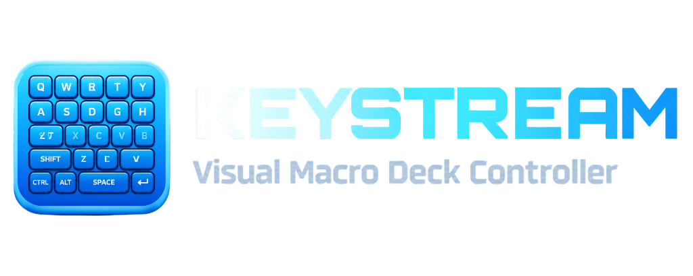
</p>

<p align="center">
  <strong>Turn a spare keyboard into a visual macro deck for Windows.</strong>
</p>

<p align="center">
  <a href="https://github.com/fldvai/keystream/releases/latest"></a>
  <a href="https://github.com/fldvai/keystream/releases/latest"></a>
  
  <a href="https://dotnet.microsoft.com/download/dotnet/8.0"></a>
  
  <a href="LICENSE"></a>
</p>

Keystream takes a second USB or Bluetooth keyboard, eats its keystrokes before
they reach Windows, and turns each key into a tile on screen: a hotkey, a media
command, an OBS action, an app launcher, a link, a sound, or a macro. The main
keyboard is never touched. Pressing a tile's key runs its action. A panic key
returns the spare keyboard to normal typing instantly.

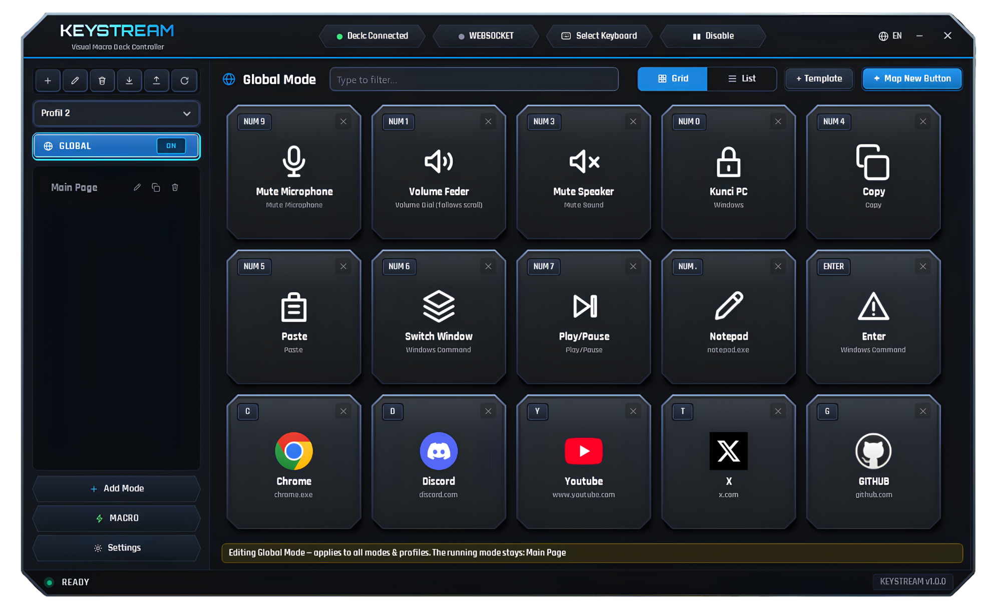

*Global Page: 15 tiles on a spare keyboard, deck connected, one Global page overlaying every profile.*

---

## Quick Start

### 1. Download
Get the latest signed installer from the releases page:
**[Download KeystreamSetup.exe](https://github.com/fldvai/keystream/releases/latest)** (~3.8 MB)

### 2. Install & Restart
1. Run **`KeystreamSetup.exe`**. The setup wizard installs Keystream to a folder you choose (default `%LocalAppData%\Keystream`) and automatically installs the low-level keyboard filter driver.
2. **Restart your PC once** so Windows can initialize the newly registered filter driver.

### 3. Pair Your Deck
Launch Keystream. The **Smart Setup Wizard** will appear. Simply press any key on your secondary keyboard to pair it as your dedicated macro deck.

---

## What it is

- **A second keyboard, not a second device.** Any spare keyboard works. It is
  identified once by hardware id, and only that keyboard is captured.
- **Tiles, not key names.** Every key shows its icon, label, and what it does.
  Clicking a tile edits it. Pressing the key runs it.
- **Profiles and pages.** Keys are grouped into pages, pages into profiles.
  One Global page overlays every profile, so shared keys work everywhere.
  Automatic profile and page switching adapts your deck to the focused
  application, with intelligent switch-back when leaving.
- **Local and offline.** Configuration lives in one JSON file on the machine.
  There is no account and no cloud. The only network use is the optional icon
  fetch and the local OBS and Streamer.bot connections (see Privacy).

## A look around

All screenshots are real captures from a Windows PC, no mockups.

| Tile grid | List view | Card editor |
| --- | --- | --- |
| 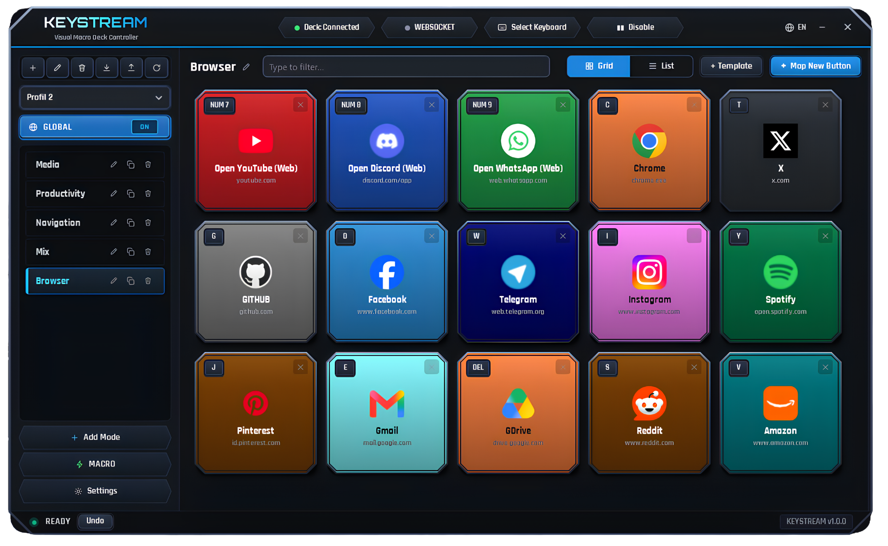<br>The Browser page in Grid view: 15 color-coded tiles, sidebar pages, connected header. | 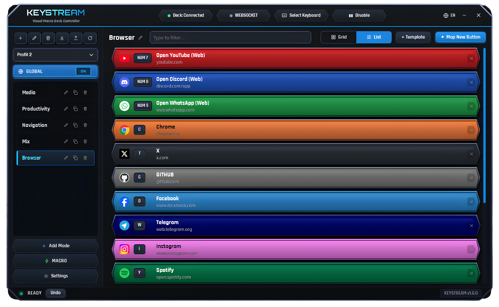<br>The same page in List view: one row per key, badge on the left. | 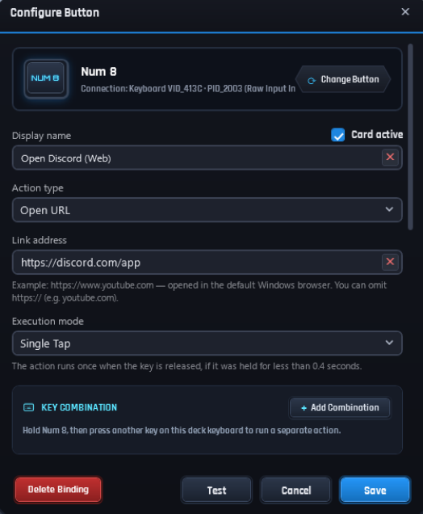<br>The card editor: action type, link address, execution mode, key combinations. |

| Icon picker | Macro editor | Settings |
| --- | --- | --- |
| 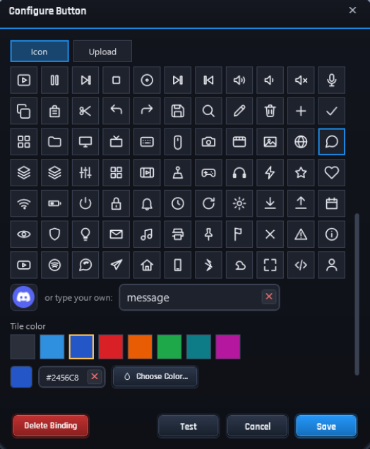<br>Icon picker and tile color in the same editor. | 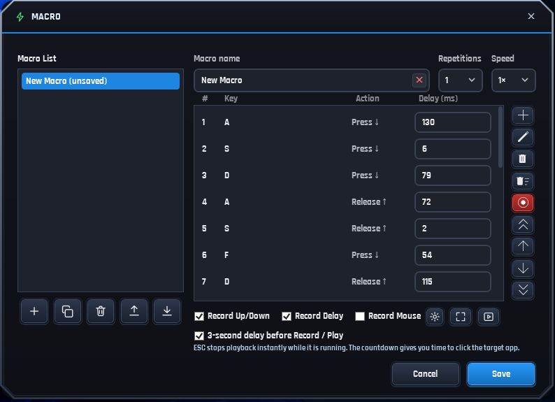<br>The macro editor: a recorded 7-step sequence with per-step delays. | 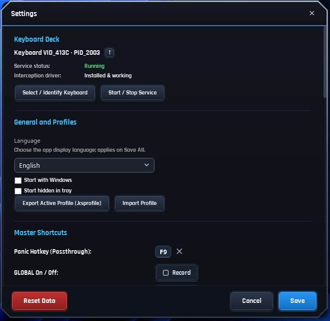<br>Settings: deck status, language, profiles, master shortcuts. |

| Select mode | Websocket config | Map new button |
| --- | --- | --- |
| 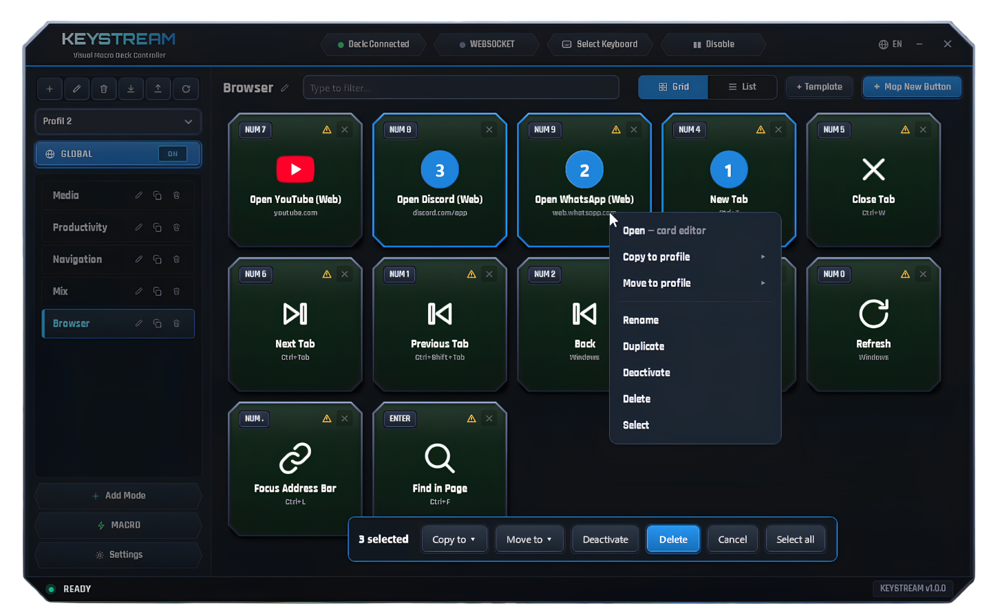<br>Select mode: 3 cards selected, context menu, bulk action bar. | 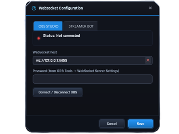<br>Websocket Configuration: OBS Studio tab, host and password. | 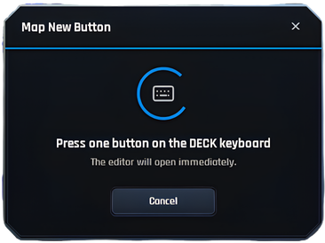<br>Mapping a new key: press one button on the deck keyboard. |

## Features

| Area | What it does |
| --- | --- |
| Deck capture | A spare keyboard is identified once and its strokes are eaten at the driver level. The main keyboard is forwarded unchanged. Panic passthrough (default F9 or Ctrl+Shift+Esc) hands the deck back to Windows at once. |
| Triggers | Tap, Long Press, Double Tap, Hold to Repeat, Hold for Layer, and Scroll Dial. Hold a key and scroll to turn a dial, for example master volume, while the scroll never reaches the game or app underneath. |
| Key combinations | Hold one deck key and press a second to run a different action. Combinations run multi-step sequences from the same editor as single keys. |
| Macros | Named step sequences stored once and referenced by cards. Record keystrokes, delays, and mouse movement, or build steps by hand. A card runs its macro; nested macros are refused. |
| Actions | Hotkeys (F1-F24 and named keys, sent as one input batch), media and volume, OBS control over obs-websocket v5 (20 commands), Streamer.bot actions over its local WebSocket server, app and file launcher, links, soundboard playback, page and profile switching, Windows commands and tools, browser profiles and groups, and mouse steps inside macros. |
| Auto-Switch & Switch-Back | Pages and profiles activate automatically when trigger applications come to the foreground. Optional switch-back remembers the previous page/profile and restores it the moment the trigger application loses focus. |
| Browser profiles | Open a browser with a chosen profile, focus its window, or toggle it. Groups open a set of browser profiles with one press. |
| Global page | Bindings on the Global page apply to every page of every profile. A per-key rule decides what wins when a page and the Global page bind the same key. The Global overlay can be switched off at runtime. Default pill navigation icons ("Prev Page", "Next Page") are seeded automatically. |
| Profile packages & import | Export and import profiles as `.ksp` packages. When imported packages include Global cards, choose between Replace, Merge (append without overwriting), or Skip. |
| Page colors & templates | Rapidly customize deck appearance with an instant 8-swatch palette that colors all tiles in a page at once. Pre-built keyboard templates with automated key fitting map your spare keyboard's layout. |
| Icons | Built-in vector catalog, uploaded images, or automatic fetch: a website favicon for links, the application icon for launchers. Automatic icons never overwrite an uploaded one. |
| Software updates | Check for latest GitHub releases manually from Settings ("Periksa Pembaruan" at the bottom) or automatically upon application startup. |
| Languages | Indonesian and English, switched from the header or Settings, applied on Save in Settings and live from the header toggle. |

## Under the hood

- **One worker thread owns the driver.** All Interception calls happen on a
  single worker thread. It never blocks on the UI, so a modal can never freeze
  the main keyboard.
- **Resolver priority is explicit.** For each key: page bindings, then legacy
  navigation bindings, then the Global page. A Global binding replaces the
  binding below it for that key only.
- **Actions run through a bounded queue.** A single dispatcher drains jobs in
  order. If the queue fills, the drop is counted and reported, not hidden.
- **Config writes are atomic.** Save goes to a temp file, fsync, then a rename,
  with three rotated backups. A corrupt file falls back through the backups.
- **Projects.** `Keystream.Core` holds pure logic with no Windows dependency.
  `Keystream.Windows` holds the Interception P/Invoke and the capture service.
  `Keystream.Actions` holds the action implementations. `Keystream.App` holds
  the WPF shell. `Keystream.SelfCheck` runs console checks over the pure logic.
  `Keystream.Setup` holds the custom WPF installer code; it is built via
  `Keystream.Setup/build-setup.sh` (canonical; `Keystream.Setup\build-setup.ps1`
  is the Windows-local alternative, which additionally attempts a best-effort
  self-signed Authenticode signature).
- **String table.** Localized strings live in `Keystream.Core/Localization/Strings.g.cs`,
  generated from `tools/merged.json` (one member per language code, 12 languages)
  by `tools/gen_strings.py`; a missing member is filled from English. Never hand-edit
  the generated file. See `WORKFLOW.md` section 12.

## Requirements

- **Operating System:** Windows 10 (version 1809 or higher) or Windows 11 (64-bit).
- **Permissions:** Administrator rights are required only during installation to configure the kernel filter driver. Daily usage runs under standard user permissions.
- **Runtime:** [.NET 8 Desktop Runtime (x64)](https://dotnet.microsoft.com/download/dotnet/8.0). (The installer will notify and prompt you if it is missing).
- **Driver:** The low-level Interception filter driver (automatically installed by `KeystreamSetup.exe`; a one-time PC reboot is required).

## Building from source

### Prerequisites
- Windows 10 / 11 (x64)
- [.NET 8 SDK](https://dotnet.microsoft.com/download/dotnet/8.0) (`global.json` pins SDK 8.0.426)
- PowerShell 7 or Windows PowerShell 5.1
- Bash (for `build-setup.sh`; Git Bash on Windows, or any Linux/macOS shell)

### Compile the Application

```powershell
git clone https://github.com/fldvai/keystream
cd keystream

# Build app and validation checks
dotnet build Keystream.App -c Release
dotnet build Keystream.SelfCheck -c Release

# Publish framework-dependent binaries
dotnet publish Keystream.App -c Release -r win-x64 --self-contained false -o publish-app
```

Then run `publish-app\Keystream.exe`. Exit any running copy from the Windows system tray first.

### Build the Standalone Installer

To compile the single-file cyber installer (`KeystreamSetup.exe`) with bundled driver package:

```bash
Keystream.Setup/build-setup.sh
```

The output binary `KeystreamSetup.exe` is left in a work directory under `/tmp` (overridable with `KEYSTREAM_SETUP_WORKDIR`).

Windows-local alternative (additionally attempts a best-effort self-signed Authenticode signature):

```powershell
cd Keystream.Setup
powershell -ExecutionPolicy Bypass -File .\build-setup.ps1
```

Its output binary `KeystreamSetup.exe` will be published at the repository root.

## Privacy and security

- No account, no cloud, no analytics.
- Configuration, icons, and logs stay on the local machine under
  `%AppData%\Keystream`. The config file is `%AppData%\Keystream\config.json`,
  with `config.json.bak1` to `config.json.bak3` automatic rotated backups.
- The app contacts the network in exactly three safe cases:
  1. Fetching a tile icon (website favicon or app icon, only when automatic icons are requested).
  2. Talking to OBS or Streamer.bot on the local machine over their local WebSocket ports.
  3. Checking for software updates: a simple GET to `api.github.com/repos/fldvai/keystream/releases/latest`, invoked manually via "Periksa Pembaruan" at the bottom of Settings or automatically on startup if enabled in Settings. No user telemetry is ever sent.
- **OBS & Streamer.bot Passwords:** The OBS password and the Streamer.bot password
  are stored locally in `%AppData%\Keystream\config.json`. They are
  never written to logs or UI text.

## Contributing

- Read `WORKFLOW.md` first. It describes the data flow, the threading rules,
  and the build routine.
- Build the app and the self-check with the commands in Get started. Both
  builds must report 0 errors. Run the self-check on Windows.
- Verification honesty: anything touching the driver, real windows, real audio, or OBS is proven only by a run on a real Windows PC.
- Do not hand-edit `Strings.g.cs`. Regenerate the string table with the
  pipeline in `WORKFLOW.md` section 12.

## License and credits

Keystream is licensed under the **MIT License**. Copyright (c) 2026 FLD. See
[`LICENSE`](LICENSE) at the repository root. Full third-party notices and license
texts are in [`THIRD-PARTY-NOTICES.md`](THIRD-PARTY-NOTICES.md).

The Interception driver is a separate component with its own license. The
shipped `interception.dll` is unmodified and is used only through P/Invoke
calls from `Keystream.Windows`. It comes from the official oblitum/Interception v1.0.1
release: https://github.com/oblitum/Interception/releases/tag/v1.0.1
Interception is licensed under the GNU Lesser General Public License version 3 (LGPLv3).

Other components:
- [NAudio 2.2.1](https://github.com/naudio/NAudio) — MIT License
- [CommunityToolkit.Mvvm 8.3.2](https://github.com/CommunityToolkit/dotnet) — MIT License
- Orbitron and Rajdhani fonts — SIL Open Font License version 1.1
